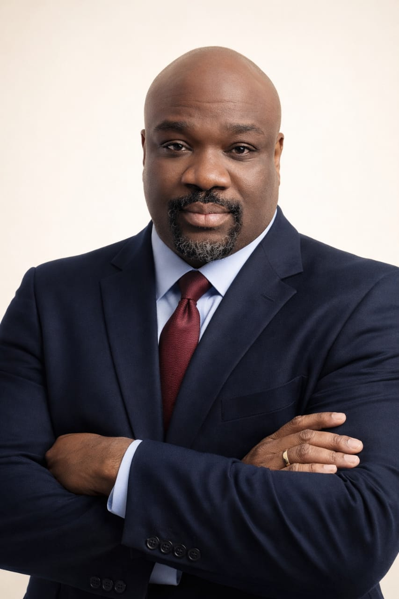
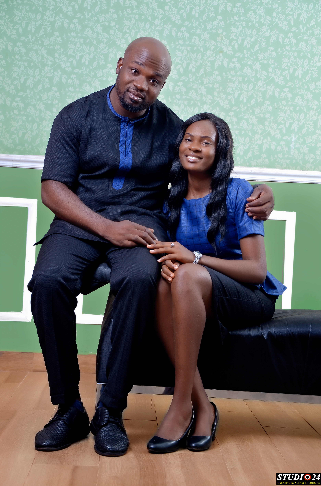
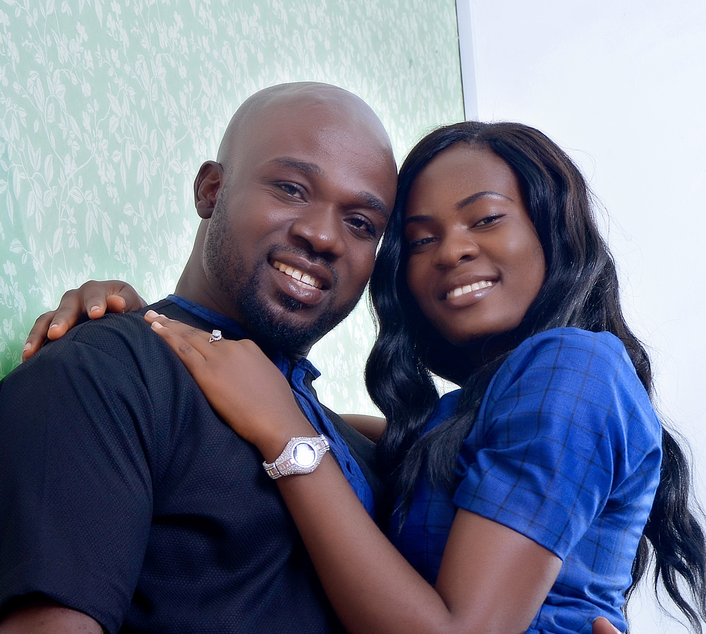
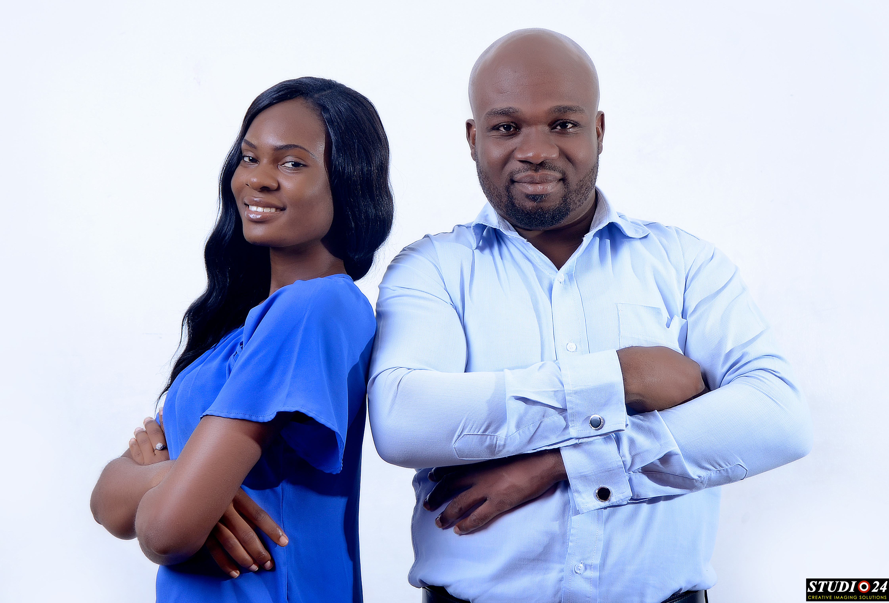

::: {.welcome-banner}
# About Me
:::

<!-- SECTION 1: ACADEMIC BACKGROUND AND RESEARCH -->

::: {.about-section .about-full}
::: {.about-container}
::: {.about-layout}
::: {.about-photo}
{fig-alt="Professional portrait of Godwin C. Umeobi"}
:::
::: {.about-biography}
## Academic Background

I am Godwin Chinemerem UMEOBI, a doctoral student in Psychometrics and Graduate Instructor in the Department of Psychology at Morgan State University, Baltimore, Maryland. My academic and professional interests span psychological measurement, quantitative research methods, human behavior, and the application of statistical and psychometric methods to understanding psychological and educational phenomena.

## Research Interests

My current research focuses on **process data, response latency, and response behavior in psychological and educational assessments**, particularly in technology-mediated assessment environments. I am interested in understanding not only the responses individuals provide to assessment items but also the underlying processes involved in producing those responses. My work explores how item characteristics, response formats, respondent attributes, and assessment delivery conditions influence response behavior, with implications for measurement validity, data quality, and the interpretation of assessment outcomes.

A central area of my research involves video-based surveys and the use of response-time data to investigate how respondents interact with assessment items. I am particularly interested in the cognitive and behavioral processes associated with item comprehension, response formulation, response selection, and non-effortful responding. Through this work, I seek to contribute to the development of more valid, reliable, and responsive measurement practices across psychological, educational, and other digital assessment settings.

My broader research background includes adolescent mental health, adverse childhood experiences, antisocial behavior, psychological resilience, social support, and psychological scale development and validation. These interests reflect my commitment to understanding human behavior through rigorous research while addressing issues with practical implications for individuals, communities, and society.
:::
:::
:::

<!-- SECTION 2: TEACHING -->

::: {.about-section .about-section-alt .about-full}
::: {.about-container}
::: {.about-layout}
::: {.about-photo}
{fig-alt="Godwin Umeobi during an academic teaching activity"}
:::
::: {.about-biography}
## Teaching and Professional Experience

Beyond research, I have extensive experience in university teaching, academic mentorship, and student development across institutions in Nigeria and the United States. Before joining Morgan State University, I held academic positions at Nnamdi Azikiwe University and Godfrey Okoye University in Nigeria. At Morgan State University, I have taught General Psychology and Psychological Statistics, with a particular interest in making statistical reasoning, research methods, and data analysis accessible and applicable to students' academic and professional development.

My professional experience also includes research appointments at Morgan State University and participation in research projects involving educational assessment, student retention, and institutional analysis. I have contributed to scholarly publications and conference presentations and serve as a peer reviewer for academic journals. I am also actively involved in professional organizations, including the American Psychological Association, the Psychometric Society, the Psychonomic Society, and the National Council on Measurement in Education.
:::
:::
:::

<!-- SECTION 3: LEADERSHIP -->

::: {.about-section .about-full}
::: {.about-container}
::: {.about-layout}
::: {.about-photo}
{fig-alt="Godwin Umeobi participating in a leadership or professional service activity"}
:::
::: {.about-biography}
## Leadership, Service, and Mentorship

Service, leadership, and mentorship are important parts of my academic journey. I have served as President of the Morgan State University Graduate Students Association, an APA Campus Ambassador, and a mentor through the NextGen Psych Scholars Program. I also contribute to professional service through academic review activities and committee membership, including the Society for the Psychological Study of Social Issues' Innovative Teaching Award Selection Committee.
:::
:::
:::

<!-- SECTION 4: EDUCATION AND GOALS -->

::: {.about-section .about-section-alt .about-full}
::: {.about-container}
::: {.about-layout}
::: {.about-photo}
{fig-alt="Godwin Umeobi at an academic or professional event"}
:::
::: {.about-biography}
## Education

I hold a Master of Science in Forensic Psychology from Godfrey Okoye University and a Bachelor of Science with Honors in Psychology from Nnamdi Azikiwe University, Nigeria. My academic training and professional experiences continue to shape an interdisciplinary approach to research that connects psychological theory, measurement science, statistical analysis, and real-world applications.

## Academic and Professional Goals

**My overarching goal is to advance the understanding of human behavior through rigorous measurement and research, contribute to improvements in assessment practices and data quality, and support the development of future scholars through teaching, mentorship, and collaborative research.**
:::
:::
:::
